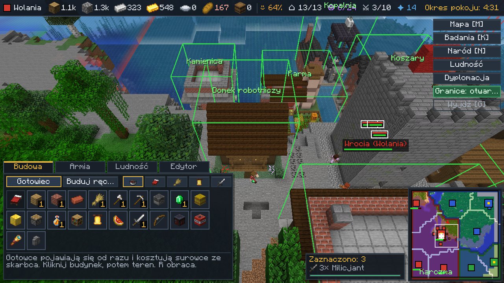
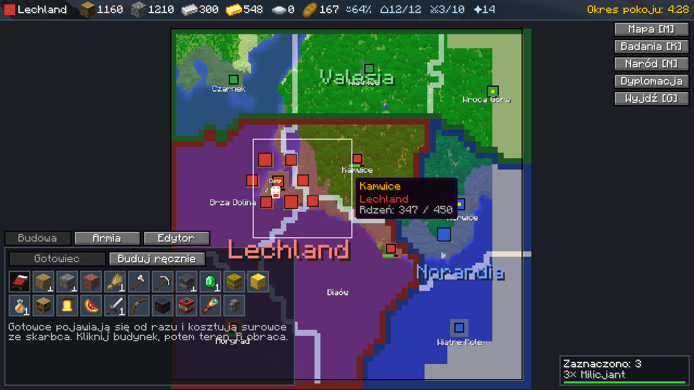
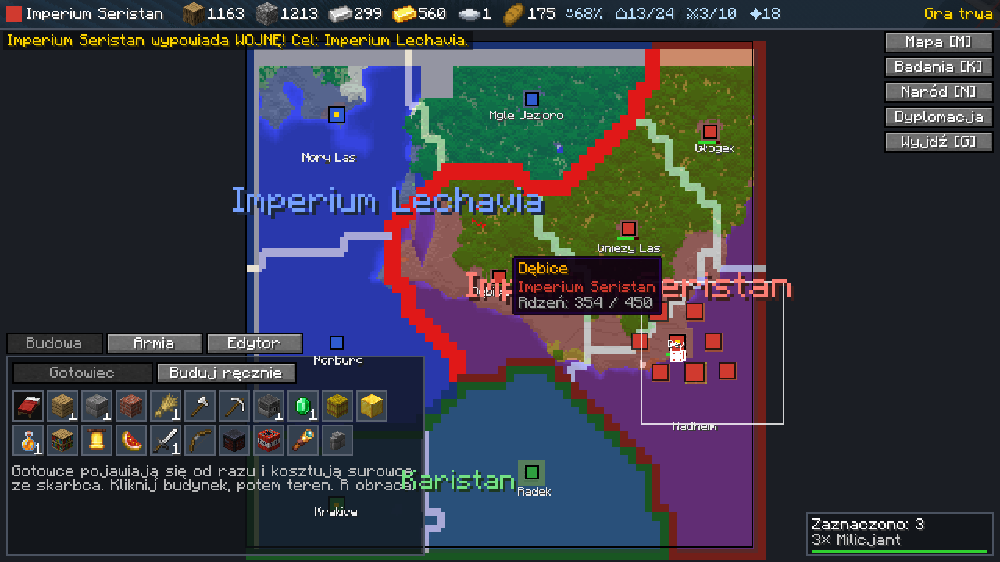
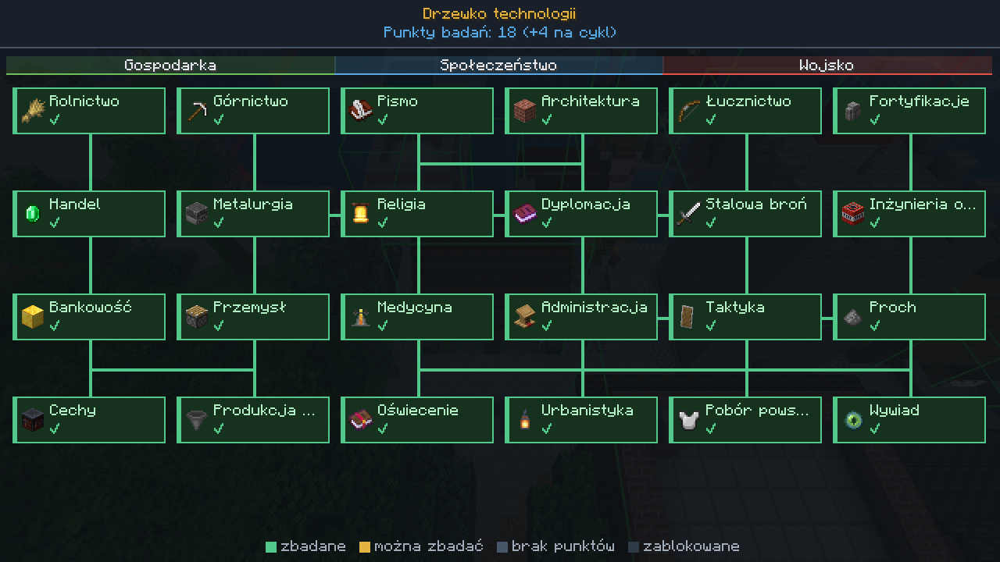
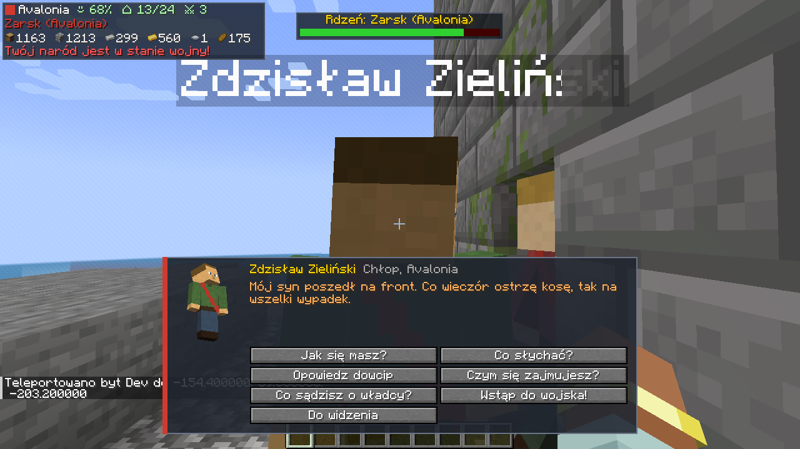
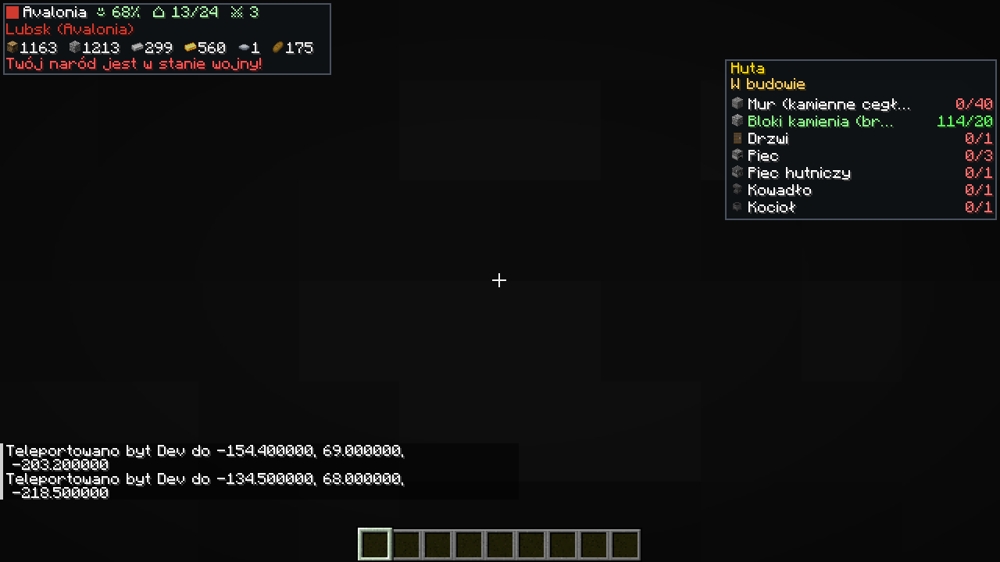
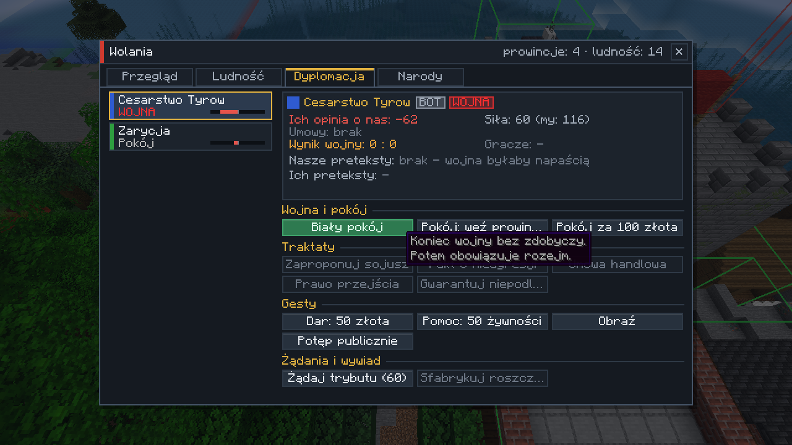
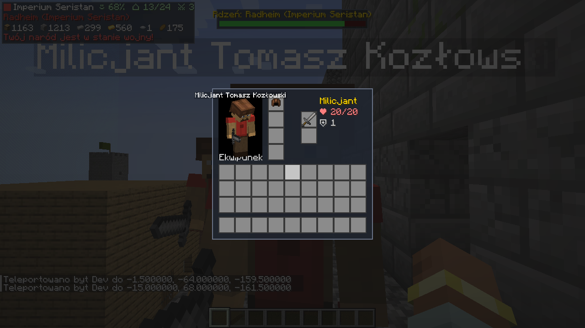

# Imperium: Strategy & Diplomacy

Mod do **Minecraft 1.20.1 / Forge 47.4.0**. Łączy Minecrafta z grą strategiczną, polityczną, dyplomatyczną i wojenną.
Gracze (i boty) prowadzą państwa podzielone na prowincje. Budują funkcyjne budynki, rozwijają drzewko technologii,
prowadzą dyplomację, wypowiadają wojny i dowodzą armiami z widoku RTS, a potem schodzą na ziemię w pierwszej osobie.

## Zrzuty ekranu

Zrzuty robi automatyczny test klienta w CI przy każdym pushu, więc zawsze pokazują aktualną wersję.

| | |
|---|---|
|  |  |
| Widok RTS: gotowe budynki, wieża prowincji, zaznaczone jednostki | Mapa strategiczna: państwa, prowincje, rdzenie, jednostki |
|  |  |
| Po wypowiedzeniu wojny granica robi się czerwona | Drzewko technologii |
|  |  |
| Rozmowa z mieszkańcem (nastrój zależy od stanu państwa) | Plac budowy: HUD pokazuje wymagane bloki |
|  |  |
| Dyplomacja | Ekwipunek żołnierza |

## Instalacja

1. Zainstaluj Minecraft Forge **1.20.1-47.4.0** (działa na każdym Forge 47.x).
2. Pobierz `imperium-1.0.0.jar` z zakładki **Actions → ostatni udany build → Artifacts (imperium-mod)**
   albo zbuduj sam (`./gradlew build`, plik pojawi się w `build/libs/`).
3. Wrzuć plik do folderu `mods` po stronie klienta i serwera.

## Szybki start (admin / host)

```
/imperium arena 500            # arena 500x500 wokół ciebie (250, 500, 1000, 1500, 2000, 2500, 3000)
/imperium autodivide 4 3       # losowy podział: 4 państwa po 3 prowincje
/imperium start                # buduje wieże prowincji, rozdziela graczy i startuje grę
```

To samo zrobisz bez komend: wciśnij **G** (widok strategiczny), otwórz zakładkę **Edytor** i wybierz rozmiar areny,
**Losuj mapę** albo maluj granice ręcznie (Pędzel / Gumka), a potem kliknij **Start**.

Gracze dołączają do państw przez **N → Narody → Dołącz** albo `/imperium join <nazwa>`.
Państwa bez graczy po starcie przejmują **boty**.

## Sterowanie

| Klawisz | Działanie |
|---|---|
| **G** | przełączanie widoku: pierwsza osoba ↔ RTS (z góry) |
| **K** | drzewko technologii |
| **N** | naród: przegląd, podatki, kronika, dyplomacja, lista narodów |
| **B** | pokaż/ukryj granice w trybie pierwszoosobowym |

**W widoku RTS:**

| | |
|---|---|
| WASD / strzałki, Shift | przesuwanie kamery (Shift: szybciej) |
| Q / E, środkowy przycisk myszy | obrót kamery (środkowy: obrót i pochylenie) |
| kółko myszy | przybliżenie |
| **M** | mapa strategiczna całej areny (granice, prowincje, jednostki, rdzenie) |
| LPM / przeciąganie | zaznaczanie jednostek (Shift dodaje, podwójny klik zaznacza ten sam typ) |
| PPM | rozkaz: natarcie w punkt, atak na wroga albo oblężenie rdzenia prowincji |
| Alt + PPM | marsz bez walki (odwrót) |
| H / X, V, B, T | stój, za mną, do koszar, zmiana postawy |
| Ctrl+1..9 / 1..9 | zapisanie / wybranie grupy |
| Ctrl+A, F, Spacja | zaznacz wszystkich, kamera na zaznaczonych, kamera na tobie |
| R | obrót wejścia stawianego budynku |
| Esc / G | wyjście z RTS |

## Jak się gra

### Terytorium i prowincje
Arena jest podzielona na państwa, a państwa na prowincje. Granice widać w RTS jako kolorowe „kurtyny” na terenie
i na mapie strategicznej. Granice wojenne są czerwone. W każdej prowincji stoi wieża z **Rdzeniem prowincji**.
Na cudzym terytorium nie zbudujesz ani nie rozkopiesz niczego, chyba że jesteście w stanie wojny.

### Budowanie
1. W RTS otwórz zakładkę **Budowa**.
2. **Buduj ręcznie:** kliknij budynek i wskaż działkę na swoim terytorium. Powstanie **Plac budowy**.
   Wejdź na niego w pierwszej osobie, a HUD pokaże listę wymaganych bloków i postęp (np. Huta: 40× mur, 3× piec,
   1× wielki piec, kowadło, kocioł). Kształt budynku jest dowolny. Gdy wszystkie wymagania są spełnione,
   budynek sam się aktywuje. Jeśli wróg zniszczy wymagane bloki, budynek przestaje działać do czasu naprawy.
3. **Gotowiec:** budynek stawiany od razu, płatny surowcami ze skarbca narodowego (np. chata za 50 drewna).

Surowce wpłacasz do **Skarbca narodowego** (stoi w wieży stolicy, można też go wytworzyć):
klikasz go PPM z pniami, kamieniem, żelazem, złotem, stalą, jedzeniem albo książkami (dają punkty badań).
Shift+PPM otwiera skarbiec i pozwala wypłacać materiały.

### Budynki

| Budynek | Działanie |
|---|---|
| Dom / Chata / Kamienny dom / Dworek | miejsca dla ludności (2 osoby na łóżko) |
| Farma | +żywność, uprawy na terytorium rosną szybciej |
| Tartak | +drewno |
| Kopalnia | +kamień i żelazo, Pośpiech dla obywateli na terytorium |
| **Huta** | piece wokół działają 3× szybciej, tylko tu działa **Piec hutniczy** (żelazo + węgiel → **stal**); zamienia żelazo w stal w skarbcu; zanieczyszczenie obniża zadowolenie |
| Targowisko | +złoto, +zadowolenie, mocniejsze umowy handlowe |
| Spichlerz | większe zapasy jedzenia, mniejsze zużycie |
| Bank | +15% złota, większe magazyny |
| Karczma | +zadowolenie, −jedzenie |
| Akademia | +punkty badań |
| Świątynia | +zadowolenie, Szczęście na terytorium |
| Lecznica | Regeneracja na terytorium, szybsze leczenie żołnierzy, szybszy przyrost |
| Koszary | rekrutacja milicji i mieczników |
| Strzelnica | łucznicy |
| Zbrojownia | rycerze, lepszy ekwipunek rekrutów |
| Warsztat oblężniczy | saperzy (6× obrażeń rdzeniom) |
| Strażnica | widzi wrogie jednostki w promieniu 96 bloków na mapie |
| Twierdza | rdzenie mają 2× więcej życia, Odporność w czasie wojny |

### Gospodarka i ludność
Co cykl (domyślnie 20 s) państwo produkuje i zużywa surowce. Ludność rośnie, jeśli jest jedzenie, miejsce w domach
i zadowolenie. Głód zabija ludzi, obniża morale i zadowolenie, a żołnierze mogą zdezerterować.
Zadowolenie zależy od podatków (niskie, normalne, wysokie), budynków, wojny, zanieczyszczenia i przeludnienia.
Po państwie chodzą **mieszkańcy** (liczba zależy od populacji).

### Drzewko technologii (K)
21 technologii w trzech gałęziach: **Gospodarka** (Rolnictwo, Górnictwo, Handel, Metalurgia, Bankowość, Przemysł, Cechy),
**Społeczeństwo** (Pismo, Architektura, Religia, Dyplomacja, Medycyna, Administracja, Oświecenie) i
**Wojsko** (Łucznictwo, Fortyfikacje, Stalowa broń, Inżynieria oblężnicza, Taktyka, Proch, Pobór powszechny).
Odblokowują budynki, jednostki i premie. Punkty badań dają ludność, Akademie i książki wpłacone do skarbca.

### Wojsko
Rekrutacja (pobór) odbywa się w zakładce **Armia**. Każdy żołnierz to jedna osoba z populacji plus koszt w surowcach.

| Jednostka | Opis |
|---|---|
| Milicjant | tani, kamienny miecz |
| Miecznik | żelazny miecz, kolczuga, tarcza |
| Łucznik | strzela z dystansu i odskakuje od walczących wręcz |
| Rycerz | pełna stalowa zbroja |
| Saper | niszczy rdzenie prowincji |

Żołnierze sami wybierają cele (ranni, atakujący ich towarzyszy, wrodzy gracze), wycofują się ranni do koszar,
trzymają szyk (z przodu walczący wręcz, z tyłu łucznicy), pilnują pozycji zgodnie z postawą (agresywna, obronna, pasywna),
otwierają drzwi i nie ranią sojuszników. Ekwipunek dajesz im, klikając żołnierza PPM z przedmiotem,
albo przez Shift+PPM (okno ekwipunku). Rozmowa z żołnierzem (PPM) pozwala też wydać rozkaz albo sprawdzić morale.

### Dyplomacja i wojna
W oknie **Dyplomacja** (N → Dyplomacja albo przycisk w RTS) możesz: wypowiedzieć wojnę (Shift+klik),
zaproponować pokój, sojusz, pakt o nieagresji, umowę handlową, wysłać dar, zażądać trybutu albo... obrazić sąsiada.
Sojusznicy bronionego państwa przyłączają się do wojny. Po pokoju obowiązuje rozejm. Złamanie paktu to zdrada,
którą wszyscy zapamiętają. Na początku gry obowiązuje okres pokoju.

**Podbój:** wejdź do wieży wrogiej prowincji i bij **Rdzeń prowincji** (albo wyślij żołnierzy prawym przyciskiem na rdzeń).
Gdy jego życie spadnie do zera, prowincja zmienia właściciela razem z budynkami i częścią ludności, a na wieży
zmienia się flaga. Utrata stolicy przenosi ją gdzie indziej. Państwo bez prowincji upada.
Wygrywa ostatnie państwo albo ostatni sojusz.

### Dialogi
Kliknij mieszkańca PPM. Możesz zapytać, jak się ma, co słychać, poprosić o dowcip, zapytać o władcę,
namówić go do wojska, dać mu jedzenie, a wrogiego mieszkańca zastraszyć. Odpowiedzi zależą od sytuacji państwa:
głodu, obfitości, wojny, przeludnienia i zadowolenia. Bywają zabawne, bywają tragiczne.

## Konfiguracja
`config/imperium-common.toml`: długość cyklu ekonomicznego, okres pokoju, rozejm, życie rdzeni, limit widocznych
mieszkańców, populacja startowa, boty, ochrona terytorium i granica świata.

## Komendy
`/imperium help | info | join <naród> | leave` oraz dla operatorów:
`arena <rozmiar> | autodivide <narody> <prowincje> | start | stop | reset | wipe | nation create <nazwa> | give <surowiec> <ilość> | research all`.

## Budowanie ze źródeł

```
./gradlew build              # jar w build/libs
./gradlew runClient          # klient deweloperski
./gradlew runGameTestServer  # testy automatyczne (GameTest)
python3 tools/gen_textures.py && python3 tools/gen_data.py   # regeneracja tekstur, tłumaczeń, modeli i receptur
```

## Ograniczenia
- Kamera RTS w trybie 3D może oddalić się od twojego ciała tylko na odległość renderowania (świat poza nią nie jest
  załadowany). Całą arenę widać na **mapie strategicznej (M)**, z której też wydasz rozkazy.
- Stolice botów i maszerujące armie są utrzymywane w pamięci (opcja `keepArmiesLoaded`), więc wojny toczą się także
  z dala od graczy. Jednostki stojące w miejscu daleko od wszystkich graczy „zasypiają” razem ze swoim chunkiem
  (ograniczenie Minecrafta).
