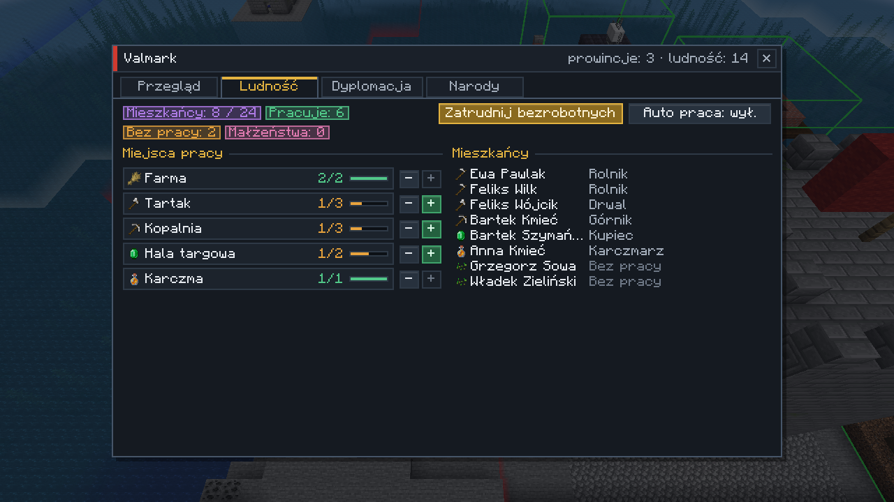
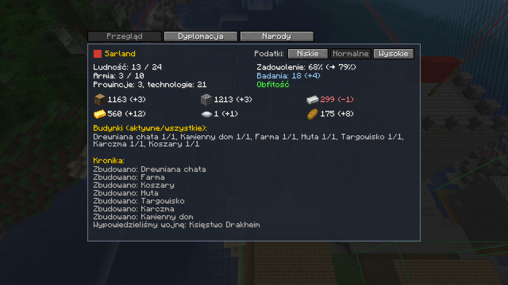
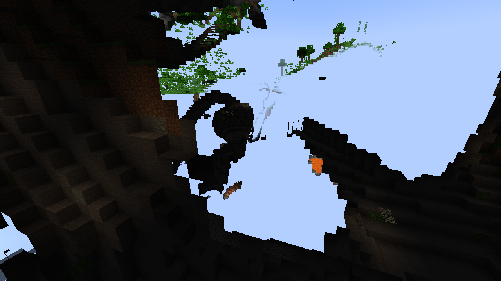
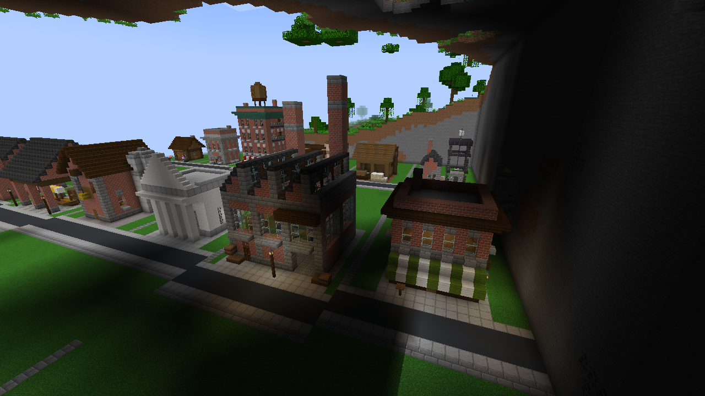

# Imperium: Strategy & Diplomacy

Mod do **Minecraft 1.20.1 / Forge 47.4.0**. Łączy Minecrafta z grą strategiczną, polityczną, dyplomatyczną i wojenną.
Gracze (i boty) prowadzą państwa podzielone na prowincje. Budują funkcyjne budynki, rozwijają drzewko technologii,
prowadzą dyplomację, wypowiadają wojny i dowodzą armiami z widoku RTS, a potem schodzą na ziemię w pierwszej osobie.

## Zrzuty ekranu

Zrzuty robi automatyczny test klienta w CI przy każdym pushu, więc zawsze pokazują aktualną wersję.

| | |
|---|---|
|  |  |
| Widok RTS: gotowe budynki, wieża prowincji, zaznaczone jednostki | Mapa strategiczna: państwa, prowincje, rdzenie, jednostki |
|  |  |
| Po wypowiedzeniu wojny granica robi się czerwona | Drzewko technologii |
|  |  |
| Rozmowa z mieszkańcem (nastrój zależy od stanu państwa) | Plac budowy: HUD pokazuje wymagane bloki |
|  |  |
| Dyplomacja: pretekst do wojny, wynik wojny, warunki pokoju | Ekwipunek żołnierza |
|  |  |
| Mieszkańcy: zawody, małżeństwa, żałoba, miejsca pracy | Przegląd narodu, granice otwarte/zamknięte |
|  |  |
| Gotowce: chata i kamienica z markizą i schodami pożarowymi (`/imperium showcase`) | Fabryka z kominami i karczma |

## Instalacja

1. Zainstaluj Minecraft Forge **1.20.1-47.4.0** (działa na każdym Forge 47.x).
2. Pobierz `imperium-1.0.0.jar` z zakładki **Actions → ostatni udany build → Artifacts (imperium-mod)**
   albo zbuduj sam (`./gradlew build`, plik pojawi się w `build/libs/`).
3. Wrzuć plik do folderu `mods` po stronie klienta i serwera.

## Szybki start (admin / host)

```
/imperium arena 500            # arena 500x500 wokół ciebie (250, 500, 1000, 1500, 2000, 2500, 3000)
/imperium autodivide 4 3       # losowy podział: 4 państwa po 3 prowincje
/imperium start                # buduje wieże prowincji, rozdziela graczy i startuje grę
```

To samo zrobisz bez komend: wciśnij **G** (widok strategiczny), otwórz zakładkę **Edytor** i wybierz rozmiar areny,
**Losuj mapę** albo maluj granice ręcznie (Pędzel / Gumka), a potem kliknij **Start**.

Gracze dołączają do państw przez **N → Narody → Dołącz** albo `/imperium join <nazwa>`.
Państwa bez graczy po starcie przejmują **boty**.

## Sterowanie

| Klawisz | Działanie |
|---|---|
| **G** | przełączanie widoku: pierwsza osoba ↔ RTS (z góry) |
| **K** | drzewko technologii |
| **N** | naród: przegląd, podatki, granice, kronika, mieszkańcy, dyplomacja, lista narodów |
| **B** | pokaż/ukryj granice w trybie pierwszoosobowym |

**W widoku RTS:**

| | |
|---|---|
| WASD / strzałki, Shift | przesuwanie kamery (Shift: szybciej) |
| Q / E, środkowy przycisk myszy | obrót kamery (środkowy: obrót i pochylenie) |
| kółko myszy | przybliżenie |
| **M** | mapa strategiczna całej areny (granice, prowincje, jednostki, rdzenie) |
| LPM / przeciąganie | zaznaczanie jednostek (Shift dodaje, podwójny klik zaznacza ten sam typ) |
| PPM | rozkaz: natarcie w punkt, atak na wroga albo oblężenie rdzenia prowincji |
| Alt + PPM | marsz bez walki (odwrót) |
| **P**, potem PPM | patrol: zaznaczeni chodzą tam i z powrotem między swoją pozycją a wskazanym punktem (Shift+PPM dodaje kolejne punkty trasy) |
| H / X, V, B, T | stój, za mną, do koszar, zmiana postawy |
| Ctrl+1..9 / 1..9 | zapisanie / wybranie grupy |
| Ctrl+A, F, Spacja | zaznacz wszystkich, kamera na zaznaczonych, kamera na tobie |
| R | obrót wejścia stawianego budynku |
| Esc / G | wyjście z RTS |

## Jak się gra

### Terytorium i prowincje
Arena jest podzielona na państwa, a państwa na prowincje. Granice widać w RTS jako kolorowe „kurtyny” na terenie
i na mapie strategicznej. Granice wojenne są czerwone. W każdej prowincji stoi wieża z **Rdzeniem prowincji**.
Na cudzym terytorium nie zbudujesz ani nie rozkopiesz niczego, chyba że jesteście w stanie wojny.

### Budowanie
1. W RTS otwórz zakładkę **Budowa**.
2. **Buduj ręcznie:** kliknij budynek i wskaż działkę na swoim terytorium. Powstanie **Plac budowy**.
   Wejdź na niego w pierwszej osobie, a HUD pokaże listę wymaganych bloków i postęp (np. Huta: 40× mur, 3× piec,
   1× wielki piec, kowadło, kocioł). Kształt budynku jest dowolny. Gdy wszystkie wymagania są spełnione,
   budynek sam się aktywuje. Jeśli wróg zniszczy wymagane bloki, budynek przestaje działać do czasu naprawy.
3. **Gotowiec:** budynek stawiany od razu, płatny surowcami ze skarbca narodowego (np. chata za 50 drewna).
   Gotowce to ręcznie zaprojektowane budynki w stylu przełomu XIX i XX wieku: ceglane kamienice z gzymsami,
   markizami i schodami przeciwpożarowymi, fabryka z kominami i świetlikami na dachu, kopalnia z wieżą wyciągową,
   bank z kolumnami. Klawisz **R** obraca wejście, a budynek stawia się zawsze przodem do wybranej strony.
   Wszystkie naraz obejrzysz komendą `/imperium showcase` (buduje ulicę gotowców obok ciebie).

Surowce wpłacasz do **Skarbca narodowego** (stoi w wieży stolicy, można też go wytworzyć):
klikasz go PPM z pniami, kamieniem, żelazem, złotem, stalą, jedzeniem albo książkami (dają punkty badań).
Shift+PPM otwiera skarbiec i pozwala wypłacać materiały.

### Budynki

| Budynek | Działanie |
|---|---|
| Dom / Chata / Kamienny dom / Dworek | miejsca dla ludności (2 osoby na łóżko) |
| Farma | +żywność, uprawy na terytorium rosną szybciej (miejsca pracy: rolnicy) |
| Tartak | +drewno (drwale) |
| Kopalnia | +kamień i żelazo, Pośpiech dla obywateli na terytorium (górnicy kopią coraz głębsze chodniki) |
| **Fabryka** | 4 robotników zamienia drewno i żelazo w **Towary**; dym z kominów obniża zadowolenie, maszyny bywają niebezpieczne |
| **Huta** | piece wokół działają 3× szybciej, tylko tu działa **Piec hutniczy** (żelazo + węgiel → **stal**); zamienia żelazo w stal w skarbcu; zanieczyszczenie obniża zadowolenie |
| Targowisko | +złoto, +zadowolenie, mocniejsze umowy handlowe |
| Spichlerz | większe zapasy jedzenia, mniejsze zużycie |
| Bank | +15% złota, większe magazyny |
| Karczma | +zadowolenie, −jedzenie |
| Akademia | +punkty badań |
| Świątynia | +zadowolenie, Szczęście na terytorium |
| Lecznica | Regeneracja na terytorium, szybsze leczenie żołnierzy, szybszy przyrost |
| Koszary | rekrutacja milicji i mieczników |
| Strzelnica | łucznicy |
| Zbrojownia | rycerze, lepszy ekwipunek rekrutów |
| Warsztat oblężniczy | saperzy (6× obrażeń rdzeniom) |
| Strażnica | widzi wrogie jednostki w promieniu 96 bloków na mapie |
| Twierdza | rdzenie mają 2× więcej życia, Odporność w czasie wojny |

### Gospodarka i ludność
Co cykl (domyślnie 20 s) państwo produkuje i zużywa surowce. Ludność rośnie, jeśli jest jedzenie, miejsce w domach
i zadowolenie. Głód zabija ludzi, obniża morale i zadowolenie, a żołnierze mogą zdezerterować.
Zadowolenie zależy od podatków (niskie, normalne, wysokie), budynków, wojny, zanieczyszczenia, przeludnienia i dobrobytu.

Każda prowincja może mieć **bogactwo naturalne** (żyzna ziemia, stare lasy, kamieniołomy, żyły żelaza, złoża złota),
które co cykl daje dodatkowe surowce. Widać je na mapie strategicznej i to dobry powód, żeby o prowincję walczyć.

**Towary** z fabryki dają dobrobyt (zadowolenie i wyższe podatki), a dzięki umowom handlowym sprzedają się
za granicę za złoto. Fabryka bez robotników prawie nic nie produkuje.

### Mieszkańcy i zawody
Po państwie chodzą imienni **mieszkańcy**. Każdy ma imię, płeć, wiek, dom, nastrój i zawód. Na początku jest ich
czterech, a z czasem jest ich więcej (+1 co 3 minuty), więcej dają też domy oraz technologie Administracja,
Urbanistyka, Produkcja masowa i Oświecenie. Limit widocznych mieszkańców ustawisz w konfiguracji.

- Zakładka **N → Mieszkańcy** pokazuje wszystkich (zawód, miejsce pracy, małżonka, żałobę, uwięzienie)
  i każdy budynek z miejscami pracy (np. farma 2/2, tartak 1/2). Przyciski **+ / −** zatrudniają i zwalniają,
  **Zatrudnij bezrobotnych** obsadza wolne miejsca, a **Auto praca** robi to sama co cykl.
- Możesz też porozmawiać z mieszkańcem (PPM) i powiedzieć **„Mam dla ciebie pracę”**. Może odmówić,
  np. gdy jest w żałobie albo bardzo niezadowolony.
- Budynek produkcyjny bez pracowników daje tylko około 1/3 produkcji, a fabryka bez robotników stoi.
- **Za dnia** pracownik idzie do swojego budynku i pracuje: drwal ścina drzewa wokół tartaku (i sadzi nowe),
  rolnik zbiera i sieje plony, kowal stoi przy kowadle, kupiec za ladą. **W nocy** wraca do domu.
- **Górnik** schodzi wejściem kopalni i drąży coraz głębsze chodniki: najpierw schody w dół, potem poziome
  sztolnie, co kilka bloków pochodnia. Wykopane rudy trafiają do skarbca. Pod ziemią czyhają niebezpieczeństwa:
  - **lawa** – górnik może w nią wpaść i zginąć,
  - **zawał** – górnika zasypuje. Jeśli w ciągu **8 minut** nie odkopiesz zasypanych bloków
    (dostajesz komunikat ze współrzędnymi), umrze z głodu,
  - zgubienie się w jaskini – trzeba do niego zejść.
- Fabryka też bywa niebezpieczna (wypadki przy maszynach).

### Rodzina, żałoba i plotki
Dorośli samotni mieszkańcy biorą ze sobą **śluby**, a małżeństwa mają **dzieci** (nowi mieszkańcy).
Wszystko ma swoją cenę:
- **małżeństwo** – para je mniej (wspólny stół), a szczęśliwe pary podnoszą zadowolenie,
- **śmierć małżonka** – wdowa albo wdowiec przez **12 minut** jest w **żałobie**: nie pracuje, mówi o tym,
  co się stało („mąż wpadł do lawy w kopalni…”), a zadowolenie państwa spada.

Inni mieszkańcy **plotkują**: w odpowiedzi na „Co słychać?” mówią o ślubach, narodzinach, wypadkach w kopalni,
uwięzionych górnikach, poległych żołnierzach, kapitulacjach i o tym, jak traktujesz jeńców.
W rozmowie możesz też zapytać o **rodzinę**.

### Granice i patrole
W **N → Przegląd** (albo przyciskiem w RTS) przełączasz **granice otwarte / zamknięte**.
- **Otwarte**: obcy mogą przechodzić (wojsko w stanie wojny i tak atakuje).
- **Zamknięte**: każdy obcy na twoim terytorium dostaje ostrzeżenie, a po kilku sekundach (gracz: 10 s,
  żołnierz: 3 s) staje się intruzem. Twoje wojsko go ściga i atakuje, także **graczy** i **milicję oraz wojsko
  innych państw**. Nie dotyczy sojuszników ani państw z **prawem przejścia**. Każde naruszenie granicy
  daje ci pretekst do wojny.

**Patrol** (klawisz **P** w RTS): zaznaczeni żołnierze chodzą wzdłuż wyznaczonego odcinka i atakują wrogów
oraz intruzów, których po drodze zobaczą.

### Kapitulacja i jeńcy
Gdy zniszczysz **rdzeń prowincji**, jej garnizon się poddaje. Gdy padnie **stolica**, poddaje się **cała armia**
tego państwa: żołnierze chowają broń, podnoszą ręce i przestają walczyć. Poddanych nie wolno atakować:
zabicie jeńca to **zbrodnia wojenna** (wszyscy to zapamiętają, a ofiara dostaje pretekst do wojny).

Porozmawiaj z jeńcem (PPM) i spróbuj go **przekonać**:
- **„Służ w mojej armii”** – przechodzi na twoją stronę z ekwipunkiem,
- **„Pracuj dla nas”** – zostaje twoim mieszkańcem (łatwiej się zgadza),
- **„Łapówka: 20 złota, dołącz”** – większa szansa na przejście do armii,
- **„Wracaj do domu”** – wraca do swoich (miłosierdzie poprawia opinię o tobie).

Przy każdej opcji widać szansę powodzenia.

Jeniec **może odmówić**, a każda kolejna próba ma mniejszą szansę. Chętniej zgadza się, gdy jego państwo głoduje,
nie płaci żołdu albo upadło, a mniej chętnie rycerz niż milicjant. Czasem przy odmowie po prostu ucieka.
Po 10 minutach niewoli jeńcy, z którymi nikt nic nie zrobił, wracają do domu.

### Drzewko technologii (K)
24 technologie w trzech gałęziach: **Gospodarka** (Rolnictwo, Górnictwo, Handel, Metalurgia, Bankowość, Przemysł, Cechy,
Produkcja masowa), **Społeczeństwo** (Pismo, Architektura, Religia, Dyplomacja, Medycyna, Administracja, Oświecenie,
Urbanistyka) i **Wojsko** (Łucznictwo, Fortyfikacje, Stalowa broń, Inżynieria oblężnicza, Taktyka, Proch,
Pobór powszechny, Wywiad).
Odblokowują budynki, jednostki i premie. Punkty badań dają ludność, Akademie i książki wpłacone do skarbca.

### Wojsko
Rekrutacja (pobór) odbywa się w zakładce **Armia**. Każdy żołnierz to jedna osoba z populacji plus koszt w surowcach.

| Jednostka | Opis |
|---|---|
| Milicjant | tani, kamienny miecz |
| Miecznik | żelazny miecz, kolczuga, tarcza |
| Łucznik | strzela z dystansu i odskakuje od walczących wręcz |
| Rycerz | pełna stalowa zbroja |
| Saper | niszczy rdzenie prowincji |

Żołnierze sami wybierają cele (ranni, atakujący ich towarzyszy, wrodzy gracze), wycofują się ranni do koszar,
trzymają szyk (z przodu walczący wręcz, z tyłu łucznicy), pilnują pozycji zgodnie z postawą (agresywna, obronna, pasywna),
otwierają drzwi i nie ranią sojuszników. Ekwipunek dajesz im, klikając żołnierza PPM z przedmiotem,
albo przez Shift+PPM (okno ekwipunku). Rozmowa z żołnierzem (PPM) pozwala też wydać rozkaz albo sprawdzić morale.

### Dyplomacja i wojna
Okno **Dyplomacja** (N → Dyplomacja albo przycisk w RTS) pokazuje przy każdym narodzie opinię o tobie, siłę armii,
traktaty, **preteksty do wojny** (wasze i ich) oraz w czasie wojny **wynik wojny**. Akcje są pogrupowane:

| Grupa | Akcje |
|---|---|
| Wojna | wypowiedz wojnę (Shift+klik), biały pokój, **pokój: weź prowincję**, **pokój za 100 złota**, **wezwij sojusznika do broni** |
| Traktaty | sojusz, pakt o nieagresji, umowa handlowa, **prawo przejścia**, **gwarancja niepodległości** (i ich zerwanie) |
| Gesty | dar złota, **pomoc żywnościowa**, obraza, **publiczne potępienie** |
| Żądania | trybut, **żądanie prowincji**, **fabrykowanie roszczenia** (wymaga technologii Wywiad) |

Boty odpowiadają na propozycje według opinii, siły i sytuacji (głód, przegrana wojna). Sojusznicy bronionego
państwa przyłączają się do wojny, a gwaranci stają w obronie. Po pokoju obowiązuje rozejm.
Na początku gry obowiązuje okres pokoju.

**Powody do wojny (casus belli).** Wojna bez pretekstu to agresja: spada zadowolenie twojego narodu, a wszyscy
sąsiedzi tracą do ciebie zaufanie. Pretekst dostajesz, gdy ktoś:
naruszy twoją zamkniętą granicę, obrazi cię lub potępi, odrzuci twoje żądanie, zerwie traktat, zabije twoich
jeńców, zostanie złapany na szpiegowaniu, trzyma prowincję, która kiedyś była twoja (**rekonkwista**), walczy
z twoim sojusznikiem albo zaatakuje kraj, któremu gwarantujesz niepodległość. Możesz też **sfabrykować roszczenie**:
szpiedzy pracują 3 minuty, ale mogą zostać złapani (wtedy to ofiara dostaje pretekst). Większość pretekstów wygasa
po kilku-kilkunastu minutach.

**Wynik wojny** rośnie za zabitych (2 pkt) i wziętych do niewoli (1 pkt) żołnierzy oraz zdobyte prowincje (15 pkt).
Od niego zależy, czy przeciwnik przyjmie pokój z oddaniem prowincji albo okupem. Zdobycie prowincji daje też
**łupy** ze skarbca przegranego.

**Podbój:** wejdź do wieży wrogiej prowincji i bij **Rdzeń prowincji** (albo wyślij żołnierzy prawym przyciskiem na rdzeń).
Gdy jego życie spadnie do zera, prowincja zmienia właściciela razem z budynkami i częścią ludności (mieszkańcy
tracą pracę w swoich budynkach), a na wieży zmienia się flaga. Utrata stolicy przenosi ją gdzie indziej
i powoduje kapitulację armii. Państwo bez prowincji upada. Wygrywa ostatnie państwo albo ostatni sojusz.

### Dialogi
Kliknij mieszkańca PPM. Możesz zapytać, jak się ma, co słychać, czym się zajmuje, o rodzinę, poprosić o dowcip,
zapytać o władcę, dać mu pracę, namówić go do wojska, dać mu jedzenie, a wrogiego mieszkańca zastraszyć.
Odpowiedzi zależą od sytuacji państwa (głód, obfitość, wojna, przeludnienie, zadowolenie) i od jego własnego życia:
zawodu, małżeństwa, żałoby, tego, co słychać w okolicy. Bywają zabawne, bywają tragiczne.

## Konfiguracja
`config/imperium-common.toml`: długość cyklu ekonomicznego, okres pokoju, rozejm, życie rdzeni, limit widocznych
mieszkańców, populacja startowa, boty, ochrona terytorium i granica świata.

## Komendy
`/imperium help | info | join <naród> | leave` oraz dla operatorów:
`arena <rozmiar> | autodivide <narody> <prowincje> | start | stop | reset | wipe | nation create <nazwa> | give <surowiec> <ilość> | research all | showcase`.

## Budowanie ze źródeł

```
./gradlew build              # jar w build/libs
./gradlew runClient          # klient deweloperski
./gradlew runGameTestServer  # testy automatyczne (GameTest)
python3 tools/gen_textures.py && python3 tools/gen_data.py   # regeneracja tekstur, tłumaczeń, modeli i receptur
python3 tools/gen_structures.py [--preview]                  # szablony gotowców (.nbt) + podglądy w tools/previews
```

## Ograniczenia
- Kamera RTS w trybie 3D może oddalić się od twojego ciała tylko na odległość renderowania (świat poza nią nie jest
  załadowany). Całą arenę widać na **mapie strategicznej (M)**, z której też wydasz rozkazy.
- Stolice botów i maszerujące armie są utrzymywane w pamięci (opcja `keepArmiesLoaded`), więc wojny toczą się także
  z dala od graczy. Jednostki stojące w miejscu daleko od wszystkich graczy „zasypiają” razem ze swoim chunkiem
  (ograniczenie Minecrafta).
